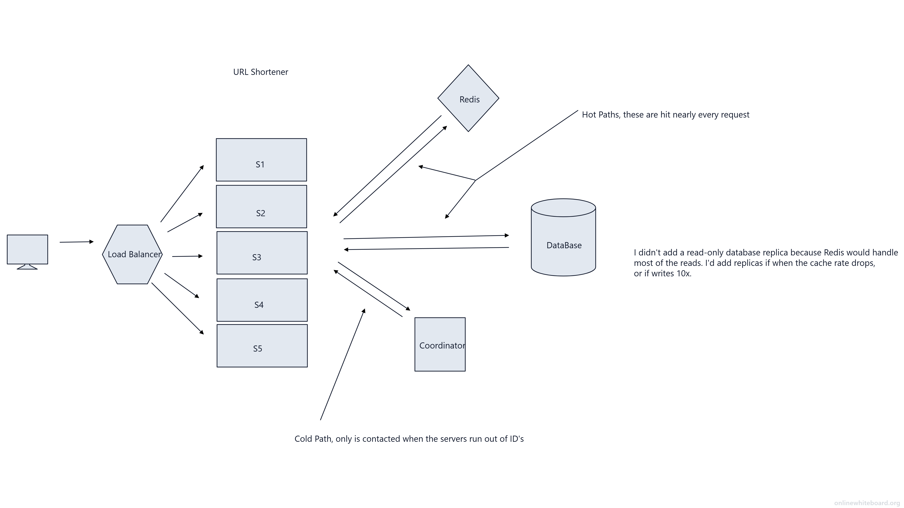

# URL Shortener — eltn.link

A URL shortener built with Java and Spring Boot: create short links, get redirected
instantly. Designed on paper first (see the design section), then built in seven
sessions, and live in production.

**Live demo:** https://eltn.link

*Initial system design exploring horizontal scaling. The current production deployment runs a single Spring Boot instance with PostgreSQL and Redis on Railway.*

## How it works

- **Short codes are base62 encodings of the database row ID.** A code is minted only
  after PostgreSQL assigns the ID, so collisions are impossible by construction —
  no random generation, no uniqueness checks, no retry loops. Every create inserts
  a new row: shortening the same URL twice gives two different codes, by design.
- **Reads are cache-aside.** A redirect checks Redis first; on a miss it reads
  PostgreSQL once and populates the cache. PostgreSQL is the source of truth.
  Cached entries carry no TTL — a link's target never changes after creation,
  so a cached value cannot go stale.
- **Creates are rate-limited** to 10 per minute per client IP (Bucket4j token
  bucket, greedy refill), checked before validation or any database write.
  Redirects are deliberately unlimited — that's the hot path.

## API

Create a link:

    POST https://eltn.link/api/links
    Content-Type: application/json

    {"url": "https://www.google.com"}

    → 201 Created
    {"shortCode": "1", "shortUrl": "https://eltn.link/1", "originalUrl": "https://www.google.com"}

Follow a link:

    GET https://eltn.link/1   → 302 Found, Location: https://www.google.com

Unknown codes return 404; invalid URLs return 400 with an explanatory message;
over the rate limit returns 429 with the wait time.

A minimal web UI is served by the app itself at the root of the domain —
no separate frontend deployment; page and API share an origin, so no CORS
configuration exists anywhere in this project.

## Load test

k6 against the warmed, Redis-cached redirect path (50 virtual users, 2 minutes,
redirects not followed so the 302 itself is measured):

| Requests | Throughput | Median | p95 | Max | Failed |
|---|---|---|---|---|---|
| 2,169,807 | ~18,082 req/s | 1.07 ms | 2.12 ms | 29.49 ms | 0 |

Measured locally against a single instance with the load generator on the same
machine — a local ceiling, not a production capacity figure.
The create endpoint was not load-tested: the rate limiter caps it at 10/min per IP,
so a load run would only measure the limiter.

## Tech stack

- Java 21, Spring Boot 4.1.2, Spring Data JPA, Spring Data Redis
- PostgreSQL 16 (source of truth), Redis 7 (cache)
- Bucket4j (rate limiting), Testcontainers + JUnit (tests), k6 (load testing)
- Multi-stage Dockerfile; deployed on Railway (app + PostgreSQL + Redis)
  with a custom domain and automatic TLS

## Run it locally

Full stack in Docker:

    docker compose up --build

    → app on http://localhost:8080

Or run the app from your IDE against just the datastores:

    docker compose up -d postgres redis

## Tests

    ./mvnw test

Seven tests, self-contained — they need only the Docker daemon.
Integration tests run against real PostgreSQL 16 and Redis 7 via Testcontainers
(no mocks, no local database), and GitHub Actions runs the same suite on every push.

## Design decisions

Every significant decision — and a few instructive mistakes — is logged in
[DECISIONS.md](DECISIONS.md): why 302 and not 301, why no cache TTL, why the
redirect route is constrained to base62 characters, and how the first production
deploy failed on a database name that was never substituted.